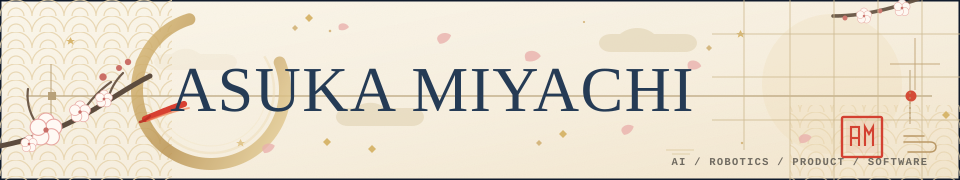
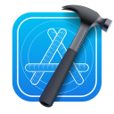
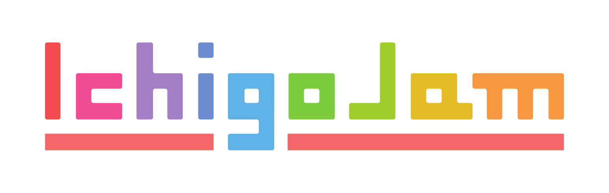

<picture>
  <source media="(max-width: 600px)" srcset="./assets/hero-v4-japanese-mobile.svg" />
  
</picture>

<h3 align="center">TOOLBOX</h3>

<h4>LANGUAGES</h4>

  

<h4>FRAMEWORKS &amp; LIBRARIES</h4>

  
  
  
  

<h4>CLOUD &amp; BACKEND</h4>

  
  

<h4>AI &amp; AGENTS</h4>

  
  
  
  
  
  <picture>
      <source media="(prefers-color-scheme: dark)" srcset="https://raw.githubusercontent.com/zai-org/ZCode/29628c9acdb81b703bbd4080c207a0e7ce5e276e/packages/ui/src/assets/cli-icons/icon-glm-for-dark.png" />
      
    </picture>
  
  
  

<h4>DESIGN &amp; ENGINEERING</h4>

  
  
  
  

<h4>DEVELOPMENT TOOLS</h4>

  
  
  
  
  
  
  
  
  
  
  

<h4 align="center">SOCIAL &amp; CONTACT</h4>

  
  
  
  
  
  

<!-- Full service inventory: docs/service-inventory.md -->
